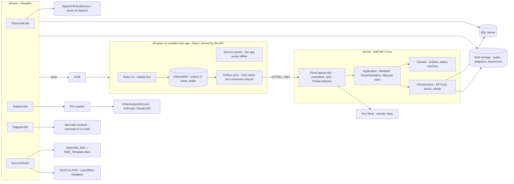
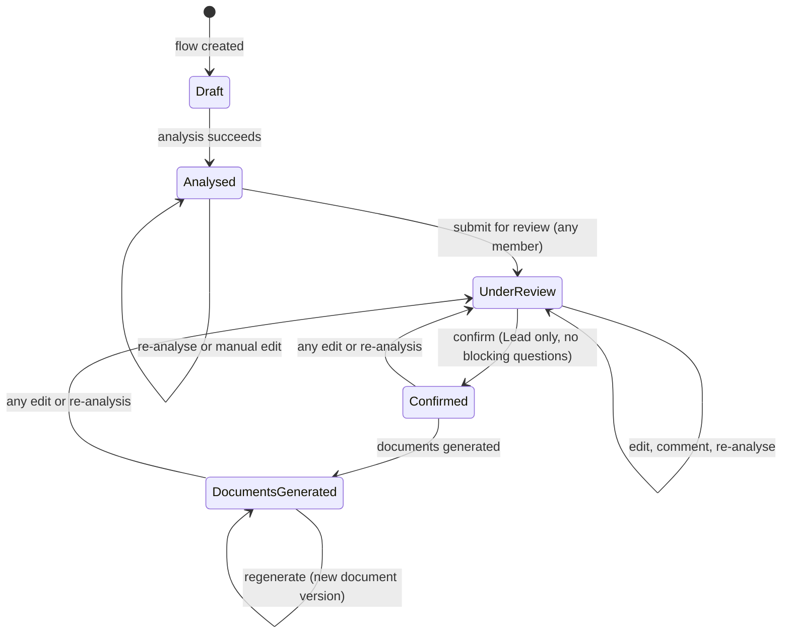
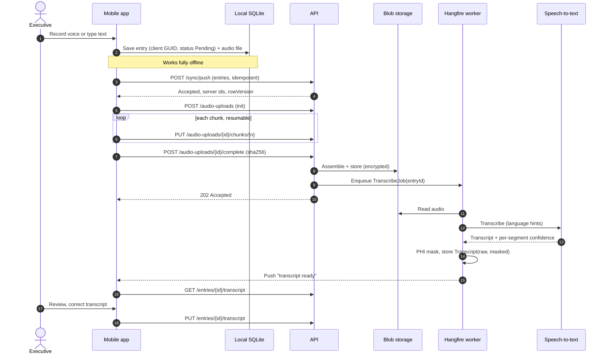
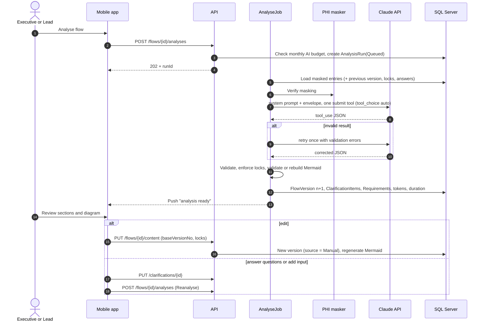
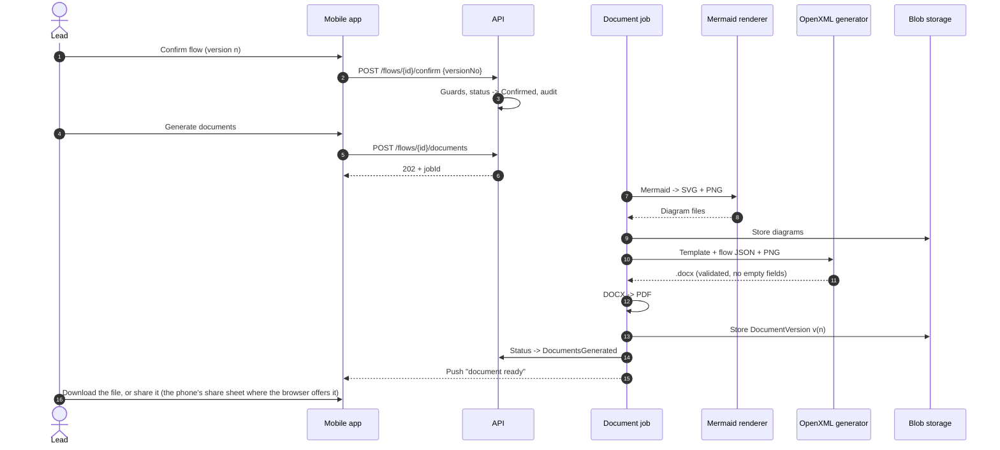
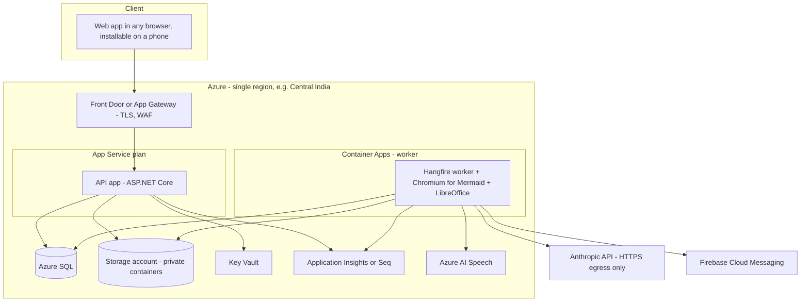

# FlowCapture: solution architecture

## 1. Component view



### Project layout and dependency rule

```
FlowCapture.Domain          no dependencies. Entities, enums, FlowStatus state machine, domain events.
FlowCapture.Shared          DTOs and contracts of the API. No EF, no server types.
FlowCapture.Application     -> Domain, Shared. Commands/queries (MediatR), validators, interfaces:
                            IFlowAnalysisService, ISpeechToTextService, IBlobStore, IDocumentGenerator,
                            IDiagramRenderer, IPhiMasker, IPushSender, IClock, ICurrentUser.
FlowCapture.Infrastructure  -> Application. EF Core + migrations, Claude client, STT client, blob stores,
                            OpenXML generator, renderers, Hangfire jobs, Serilog, audit interceptor.
FlowCapture.Api             -> Application, Infrastructure (composition root only).
web/                        The web app (React + TypeScript). Talks to the API over HTTPS only; the API serves the built files from wwwroot.
```

> **Direction change (Phase 5, after the first design):** the native Android/Windows app (.NET MAUI Blazor Hybrid) and a Blazor web host were built and then cancelled in favour of one web app that opens from a shared link and installs on a phone like an app. Their code is kept in `archive/blazor-and-maui/`. Where this document describes the phone app (sections 5 and 6, and the deployment view), read "the web app". The web app keeps the same server contract; its offline support is simpler than section 6 describes (see `docs/05-web-app.md`).

### Key design decisions

| Decision | Choice | Why |
|---|---|---|
| Content storage | `FlowVersion.Content` = one JSON document (`flow.v1`) | The AI output schema, the edit surface and the stored version are the same shape, so diff, rollback and re-analysis are simple. Query-heavy fields (requirements, open questions, status) are projected into relational tables (`Requirement`, `ClarificationItem`) from the current version. |
| Async work | Hangfire on SQL Server | Needed for transcription, analysis, rendering and generation. Retries with backoff, dashboard, idempotent job keys. |
| Idempotency | Client GUIDs on all captured data + `Idempotency-Key` header on creating POSTs + `(flowId, inputHash, promptHash)` de-dup for AI runs | Sync and AI calls can be retried without duplicates or double token cost. |
| Concurrency | A `ConcurrencyStamp` (GUID, rotated on every save) on mutable aggregates; `baseVersionNo` on flow edits; the analysis job refuses to save if the flow changed while it ran | A stale edit returns 409 with the server copy, never overwrites silently. A GUID stamp works the same on SQL Server and SQLite, so tests run on both. |
| Structured output | One tool whose input schema is the flow schema, `tool_choice: auto`, server validation, one retry | Current Claude models reject forced `tool_choice`, so the prompt tells the model to call the tool and a reply without the call is an error. The server is the final authority on the result. The retry is a fresh request that carries the validation errors and the previous output (no replayed assistant turn, so no thinking-block rules apply). |
| Secrets | Key Vault; API keys never leave the server | Mobile only holds a JWT. |
| Audit | EF `SaveChanges` interceptor writes `AuditLog` rows (old/new JSON, user, correlation id) | Full trail without per-handler code. |

## 2. Flow status lifecycle



| Transition | Who | Guard |
|---|---|---|
| Draft -> Analysed | system | A valid analysis result is saved as a new version. |
| Analysed/UnderReview -> UnderReview | Executive (own entries), Lead | At least one version exists. |
| UnderReview -> Confirmed | **Lead only** | Latest version passes schema validation; no unresolved clarification marked **blocking**; the Lead explicitly confirms that exact version number. |
| Confirmed -> DocumentsGenerated | system | Document + diagram jobs succeed. |
| Confirmed / DocumentsGenerated -> UnderReview | any edit, re-analysis or rollback | Confirmation is voided; the old confirmed version stays in history and its documents remain downloadable as earlier versions. |

Only `Confirmed` and later allow document generation. Unresolved non-blocking questions are allowed through and appear in section 19 "Open issues and clarifications" of the document.

## 3. Sequence: capture, sync, transcribe



## 4. Sequence: analyse, review, re-analyse



## 5. Sequence: confirm and generate



## 6. Offline sync design

> **What is built:** typed notes are saved in the browser (IndexedDB) first, get their id on the device, and are sent with retry whenever the connection is there; a draft is kept while typing; the app files are cached by a service worker. Everything else (lists, flows, review, documents) is read from the server and needs a connection. The full design below (encrypted local database, pull sync, conflict copies, resumable audio) was made for the native phone app and is **not** built in the web app.

**Principle:** the device is the source of truth for what the user captured; the server is the source of truth for what the system derived (transcripts, analyses, versions, documents).

| Concern | Design |
|---|---|
| Local store | SQLite with SQLCipher (key in Android Keystore / iOS Keychain). Tables: `LocalEntry`, `LocalAudio`, `OutboxOp`, plus read caches for projects, departments, flows, clarifications and the last pulled flow versions. |
| Identity | Entries and audio get a **client GUID** at creation. The same GUID is the server primary key, so retries are naturally idempotent. |
| Outbox | Every local change appends an `OutboxOp` (type, payload, attempt count, next-attempt time, state). The engine drains it in order per entry, with exponential backoff and jitter, when connectivity returns or the app starts. |
| Push | `POST /sync/push` takes a batch of ops, returns a per-op result: `Applied`, `Duplicate` (already applied, treated as success), `Conflict` (with the server copy), or `Rejected` (validation, not retried). |
| Pull | `GET /sync/pull?since=<token>` returns changed entries, transcripts, clarifications, flow status and new version numbers since the opaque cursor. Server-derived data is read-only on the device. |
| Audio | Resumable chunked upload (default 1 MB chunks). `GET /audio-uploads/{id}` returns the received chunk numbers so an interrupted upload continues, not restarts. Final SHA-256 is checked. Local audio is deleted only after the server confirms the checksum and the retention setting allows. |
| Conflicts | Only the entry's own text/notes can conflict (edit on two devices). Server compares `rowVersion`. On `Conflict` the device keeps both: the server text and the user's text as a "conflict copy", and asks the user to pick or merge. Nothing is silently lost. Entries are never overwritten by a different user (executives can edit only their own). |
| Visible status | Per entry: `Saved on device`, `Uploading n%`, `Synced`, `Transcribing`, `Transcript ready`, `Needs attention` (conflict or rejected). A global banner shows pending count and last sync time. |
| Offline limits | Capture, typing, recording, transcript edit (once pulled), answering questions and comments work offline. Analyse, confirm, generate and downloads need a connection and are disabled with a clear message. |

## 7. Security and privacy

| Area | Control |
|---|---|
| Transport | HTTPS only, HSTS, TLS 1.2+; certificate pinning in the app is optional (off by default). |
| AuthN/Z | JWT (15 min) + rotating refresh token (stored in SecureStorage). Role policies (Executive, Lead, Reviewer, Admin) and **per-project membership** checked in an authorisation handler on every project-scoped call, not only in the UI. |
| At rest | Azure SQL TDE; Blob server-side encryption (customer-managed key optional); SQLCipher on device; audio in app-private storage. |
| PHI | `IPhiMasker` runs on the typed or transcribed text: regex for phone numbers, UHID/IP-number patterns (configurable), plus a name dictionary and an optional NER step. The masked text is what is stored for analysis and what is sent to Claude. Raw transcript is stored separately with restricted access. The user sees the masked text before analysis. Masking is best-effort, not a guarantee. |
| Prompt injection | Entry text is XML-escaped and declared as data in the prompt; the tool schema limits what the model can emit; the model has no tools beyond the one submit function; the server validates and enforces locks. |
| Secrets | Key Vault (Claude key, STT key, DB, storage, JWT signing key). Nothing in `appsettings` of the app. |
| Audit | `AuditLog` for every create/update/delete (who, when, entity, old and new values, correlation id). Confirmations, role changes, prompt activations and downloads are explicit audit events. |
| AI cost | `AnalysisRun` records tokens in/out, cached tokens, model, prompt hashes, duration, cost estimate. Admin sets a monthly limit per project and globally. Calls are refused (clear message) when exceeded, with an admin override. |
| Logging | Serilog JSON, correlation id on every request and job, no entry text or transcripts in logs (ids and lengths only). Health: `/health/live`, `/health/ready` (SQL, blob, Hangfire, AI key present). |

## 8. Deployment view (Azure default)



On-prem alternative (same code, different adapters): IIS or Kestrel behind the hospital reverse proxy; SQL Server; `FileSystemBlobStore` on an encrypted volume; Kroki and LibreOffice as local containers; STT via a self-hosted engine behind `ISpeechToTextService`; Claude API reachable only through an egress proxy with an allow-list.

Environments: Dev (local Docker: SQL Server, Azurite, Kroki), Test, Prod. One Hangfire server for jobs is enough at the stated scale; the worker scales out by adding replicas because jobs are idempotent.

## 9. Requirement-to-design traceability (short)

| Your requirement | Where it lives |
|---|---|
| Offline-first, per-entry sync status | Section 6, `OutboxOp`, `/sync/*`, `/audio-uploads/*` |
| Part and whole analysis | `AnalyseJob`, prompts `part-analysis`, `whole-analysis`, `AnalysisRun.Scope` |
| Edit, re-analyse, answers, locks | `reanalysis` prompt, lock enforcement in `FlowResultValidator`, `PUT /flows/{id}/content` |
| Versions, diff, rollback | `FlowVersion`, `/flows/{id}/versions/*` |
| Lifecycle, Lead-only confirm | Section 2, `FlowStatusMachine` in Domain |
| Documents + diagrams | Section 5, `DocumentJob`, `DiagramJob`, `04-rgd-mapping.md` |
| Cost control, audit, PHI | Section 7 |
