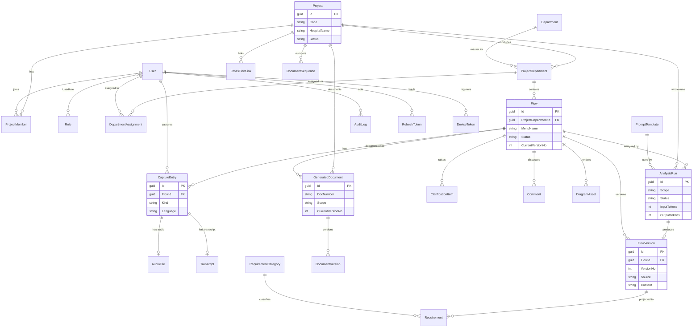

# FlowCapture: database design (SQL Server, EF Core)

## 1. Conventions

- Primary keys are `uniqueidentifier`. Entities captured on the device (`CaptureEntry`, `AudioFile`, `Comment`) use **client-generated GUIDs**. Others use `NEWSEQUENTIALID()` defaults.
- Every mutable table has `CreatedAt`, `CreatedBy`, `UpdatedAt`, `UpdatedBy` (UTC `datetime2`) and `ConcurrencyStamp` (GUID string rotated by the save interceptor; used as the optimistic-concurrency token and returned to clients as `rowVersion`). Deletes are soft (`IsDeleted`) for captured and reviewed data.
- Enums are stored as strings (`nvarchar(32)`), so the data stays readable and migrations are safe. **Never use `<` or `>` on an enum in a query**: SQL compares the text alphabetically (for example `DocumentsGenerated` sorts before `Draft`). Compare for equality or use an explicit list.
- JSON columns are `nvarchar(max)` with `CHECK (ISJSON(col) = 1)`.
- `AuditLog` rows are written by a `SaveChanges` interceptor for every entity except `AuditLog` itself, `AnalysisRun` token columns and Hangfire tables.
- Collation `Latin1_General_100_CI_AS_SC_UTF8` for UTF-8 text (Indian-language transcripts).

## 2. ER diagram

## 3. Tables

Types: `G` = guid, `S(n)` = nvarchar(n), `D` = datetime2, `B` = bit, `I` = int, `J` = JSON nvarchar(max). `*` = required. Audit columns and `RowVersion` are implied on every mutable table and not repeated.

### Identity and access

| Table | Columns | Notes |
|---|---|---|
| **User** | Id G*, Email S(256)* unique, DisplayName S(120)*, PasswordHash S(256), IsActive B*, PreferredLanguage S(10), LastLoginAt D | ASP.NET Core Identity compatible. |
| **Role** | Id G*, Name S(40)* unique | Seeded: `ImplementationExecutive`, `ImplementationLead`, `Reviewer`, `Admin`. |
| **UserRole** | UserId G*, RoleId G* | PK (UserId, RoleId). |
| **ProjectMember** | ProjectId G*, UserId G*, ProjectRole S(40)* | PK (ProjectId, UserId). Per-project access control; `ProjectRole` is one of the 3 non-admin roles. |
| **RefreshToken** | Id G*, UserId G*, TokenHash S(128)*, ExpiresAt D*, RevokedAt D, ReplacedByTokenId G, DeviceInfo S(200) | Rotating; only the hash is stored. |
| **DeviceToken** | Id G*, UserId G*, Platform S(10)*, PushToken S(512)*, LastSeenAt D | For FCM. |

### Project structure

| Table | Columns | Notes |
|---|---|---|
| **Project** | Id, Code S(30)* unique, HospitalName S(200)*, Location S(200), StartDate D*, LeadUserId G*, Status S(20)* (`Active`, `OnHold`, `Completed`), MonthlyAiTokenLimit I (null = global default) | |
| **Department** | Id, Code S(20)* unique (`MRD`, `OT`...), Name S(120)*, IsActive B* | Master list (admin). |
| **ProjectDepartment** | Id, ProjectId*, DepartmentId G (null for custom), CustomName S(120), ModuleCode S(20)*, IsActive B* | Unique (ProjectId, ModuleCode). Custom departments get their own code. |
| **DepartmentAssignment** | ProjectDepartmentId*, UserId* | PK both. Executives assigned to a department. |
| **Flow** | Id, ProjectDepartmentId*, MenuName S(200)* (default `General`), Status S(30)* (`Draft`, `Analysed`, `UnderReview`, `Confirmed`, `DocumentsGenerated`), CurrentVersionNo I, ConfirmedVersionNo I, ConfirmedBy G, ConfirmedAt D, LastActivityAt D* | Unique (ProjectDepartmentId, MenuName). |

### Capture

| Table | Columns | Notes |
|---|---|---|
| **CaptureEntry** | Id (client GUID), FlowId*, CapturedBy G*, CapturedAt D* (device time), Kind S(10)* (`Text`, `Voice`), IntervieweeName S(120), IntervieweeRole S(120), Language S(10)*, RawText nvarchar(max), Notes nvarchar(max), SyncState S(20)* (`Received`), IsDeleted B* | `IntervieweeName` is stored but never sent to the AI. RawText is encrypted at rest by TDE; column-level Always Encrypted is optional. |
| **AudioFile** | Id (client GUID), EntryId* unique, BlobPath S(400)*, ContentType S(60)*, DurationSec I, SizeBytes bigint*, Sha256 char(64)*, UploadState S(20)* (`Initiated`, `Uploading`, `Complete`, `Failed`), ReceivedChunks S(max) | |
| **Transcript** | Id, EntryId* unique, Provider S(40), Language S(10), RawText nvarchar(max), MaskedText nvarchar(max), UserEditedText nvarchar(max), Status S(20)* (`Queued`, `Processing`, `Ready`, `Failed`), SegmentsJson J, AvgConfidence decimal(4,3), MaskedCount I | The text sent to the AI is `COALESCE(UserEditedText re-masked, MaskedText)`; user edits are re-masked on save. |
| **Attachment** (phase 2) | Id, EntryId*, BlobPath*, ContentType*, Caption | Not built in MVP. |

### Analysis and versions

| Table | Columns | Notes |
|---|---|---|
| **PromptTemplate** | Id, Key S(80)*, Version I*, Content nvarchar(max)*, Sha256 char(64)*, IsActive B*, Notes S(400) | Unique (Key, Version). One active per key. |
| **AnalysisRun** | Id, Scope S(10)* (`Part`, `Whole`), Mode S(12)* (`Initial`, `Reanalyse`), ProjectId*, FlowId (null for Whole), Status S(15)* (`Queued`, `Running`, `Succeeded`, `Failed`, `Cancelled`), InputHash char(64)*, PromptTemplateIds J*, SystemPromptSha256 char(64)*, Model S(60)*, InputTokens I, OutputTokens I, CachedInputTokens I, EstimatedCost decimal(10,4), DurationMs I, Attempts I*, ErrorCode S(40), ErrorDetail S(1000), RawOutput nvarchar(max), RequestedBy G*, StartedAt D, FinishedAt D, ResultFlowVersionId G, ResultJson J | `InputHash` = hash of entry ids + texts + previous version + locks + answers. A run with the same hash, prompt and model within a window returns the existing run. `RawOutput` is kept only on failure. For Whole runs, `ResultJson` holds the `project-analysis.v1` result. |
| **FlowVersion** | Id, FlowId*, VersionNo I*, Source S(15)* (`Analysis`, `Manual`, `Rollback`), AnalysisRunId G, ParentVersionNo I, Content J* (`flow.v1`), LockedIds J* (array), ChangeSummary S(1000), IsConfirmed B* | Unique (FlowId, VersionNo). **Immutable.** Never updated after insert except `IsConfirmed`. |
| **Requirement** | Id, FlowId*, FlowVersionId*, ReqId S(10)*, Description nvarchar(1000)*, CategoryCode S(10)*, Priority S(20)*, IsCurrent B* | Projection of the current version for search, dashboard and cross-flow ReqId uniqueness. Rebuilt on every new version (rows for older versions kept with `IsCurrent = 0`). |
| **RequirementCategory** | Code S(10) PK, Name S(60)*, Definition S(400)*, IsActive B*, SortOrder I | Seeded CR, NR, ER. Feeds the prompt and schema. |
| **ClarificationItem** | Id, FlowId*, QuestionKey S(10)* (`Q1`...), FirstSeenVersionNo I*, Section S(40)*, Question nvarchar(1000)*, RelatedGapText nvarchar(1000), Options J, Status S(15)* (`Open`, `Answered`, `Dismissed`), IsBlocking B*, Answer nvarchar(2000), AnsweredBy G, AnsweredAt D, ClientId G | Carried across versions by `QuestionKey`. The answer text is sent back as `A#` on re-analysis. Dismissed requires a reason (audited). |
| **CrossFlowLink** | Id, ProjectId*, FromFlowId*, FromItemId S(10)*, ToFlowId*, ToItemId S(10)*, Description nvarchar(1000)*, DataPassed J, Basis S(40)*, Status S(10)* (`Proposed`, `Accepted`, `Rejected`), AnalysisRunId*, DecidedBy G, DecidedAt D | From whole-project analysis. |
| **Comment** | Id (client GUID), FlowId*, Section S(40)*, ItemId S(20), ParentCommentId G, Text nvarchar(2000)*, IsResolved B*, ResolvedBy G | For Reviewers and the team. |

### Outputs

| Table | Columns | Notes |
|---|---|---|
| **DiagramAsset** | Id, FlowId (null for combined), ProjectId*, FlowVersionNo I, Kind S(10)* (`Flow`, `Combined`), MermaidSource nvarchar(max)*, SvgPath S(400), PngPath S(400), MermaidPath S(400), Sha256 char(64) | Regenerable from `MermaidSource`. |
| **DocumentSequence** | ProjectId*, ModuleCode S(20)*, LastNumber I* | PK (ProjectId, ModuleCode). Updated with `UPDLOCK, HOLDLOCK` so numbers are gap-free and unique under concurrency. |
| **GeneratedDocument** | Id, ProjectId*, Scope S(10)* (`Flow`, `Project`), FlowId G, DocNumber S(40)* (e.g. `MRD-003`; project docs `PRJ-<code>-C01`), Title S(300)*, CurrentVersionNo I*, AssignedBy S(120), Status S(20)* | Unique (ProjectId, DocNumber). |
| **DocumentVersion** | Id, GeneratedDocumentId*, VersionNo I*, SourceFlowVersions J* (`[{flowId, versionNo}]`), DocxPath S(400)*, PdfPath S(400)*, TemplateVersion S(40)*, DiagramAssetIds J, Sha256 char(64)*, ApprovalStatus S(15)* (`Pending`, `Approved`, `Rejected`), ApprovedBy G, ApprovedAt D, GeneratedBy G*, GeneratedAt D* | Unique (GeneratedDocumentId, VersionNo). Old versions stay downloadable. |
| **DocumentTemplate** | Id, Name S(80)*, Version S(40)*, BlobPath S(400)*, IsActive B*, UploadedBy G | The Word template; an admin uploads a new one. |

### System

| Table | Columns | Notes |
|---|---|---|
| **AuditLog** | Id bigint identity, At D*, UserId G, Action S(20)* (`Create`, `Update`, `Delete`, `Confirm`, `Download`, `Login`...), EntityType S(60)*, EntityId S(60)*, ProjectId G, OldValues J, NewValues J, CorrelationId S(40), IpAddress S(45) | Append-only (DB permission removes UPDATE/DELETE). |
| **SystemSetting** | Key S(80) PK, Value nvarchar(max)*, UpdatedBy G | Keys: `Ai.Model`, `Ai.MonthlyTokenLimitGlobal`, `Audio.MaxMinutes`, `Languages`, `Pii.NameDictionary`, `Pii.Patterns` ... |
| **Language** | Code S(10) PK, Name S(60)*, SttLocale S(20)*, IsActive B* | `en-IN`, `ta-IN`, `hi-IN`. |

### Columns added during the build (beyond the tables above)

| Table | Added | Why |
|---|---|---|
| CaptureEntry | `RefNo` int, unique per flow | The stable `E#` number that AI results cite. Never reused, so it survives deletes. |
| AudioFile | `ChunkSizeBytes`, `TotalChunks` | Resumable upload bookkeeping. The AudioFile id is the upload id. |
| AnalysisRun | `ParametersJson`, `Warnings` (JSON array), `ResultVersionNo` | Which entries or flows were selected; lock restorations and diagram rebuilds; the version the run produced. |
| Flow | `Clarifications` navigation | Used for open-question counts. |
| IdempotencyRecord | new table, key (Key, UserId) | Replays the first response for a repeated `Idempotency-Key`. |
| DocumentVersion | `ApprovalNote` | Reviewer note on approve or reject. |

Audit rows carry a `ProjectId` only when the changed entity already has its project loaded (no extra queries). Filter by `entityType` and `entityId` for exact history.

## 4. Indexes and constraints (beyond PKs and uniques above)

- `CaptureEntry (FlowId, CapturedAt DESC) WHERE IsDeleted = 0`
- `CaptureEntry (CapturedBy, CapturedAt DESC)`; `Transcript (Status)` for the worker queue.
- `Flow (ProjectDepartmentId, Status)` and `Flow (LastActivityAt DESC)` for the dashboard and "what's pending".
- `FlowVersion (FlowId, VersionNo DESC)`; `Requirement (FlowId, IsCurrent)`; `ClarificationItem (FlowId, Status)`.
- `AnalysisRun (ProjectId, StartedAt)` for monthly token totals, `AnalysisRun (InputHash)` for de-dup.
- `AuditLog (EntityType, EntityId, At DESC)` and `(ProjectId, At DESC)`.
- Check constraints for all enum-like string columns; `Flow.ConfirmedVersionNo <= CurrentVersionNo`; `FlowVersion` insert-only enforced by a trigger or by removing UPDATE permission on all columns but `IsConfirmed`.

## 5. How versioning, edits and requirements fit together

1. Analysis or manual edit inserts a new `FlowVersion` with the full `Content` (no deltas) and the `LockedIds` in force. Diff between versions is computed on read by comparing items by id.
2. `Flow.CurrentVersionNo` moves to the new number; rollback creates a **new** version copying an old one (`Source = Rollback`), so history is never rewritten.
3. On every new version the server rebuilds `Requirement` and syncs `ClarificationItem` (new question ids are inserted; ids missing from the new result are marked `Answered`/closed if answered, otherwise kept `Open` since the AI is told to keep unresolved ones).
4. Confirmation records `ConfirmedVersionNo`. Documents are generated from exactly that version and record it in `DocumentVersion.SourceFlowVersions`.

## 6. Mobile (SQLite) tables

`LocalEntry`, `LocalAudio`, `OutboxOp(Id, EntryId, Type, PayloadJson, State, Attempts, NextAttemptAt, LastError)`, `SyncState(Key, Value)` (pull cursor), and read-only caches `CachedProject`, `CachedFlow`, `CachedFlowVersion(FlowId, VersionNo, ContentJson)`, `CachedClarification`, `CachedTranscript`. A cache row is replaced only by a newer server `RowVersion` or `VersionNo`.

## 7. Entity classes (written in Phase 2)

One C# class per table above in `FlowCapture.Domain`, EF configurations (`IEntityTypeConfiguration<T>`) in `FlowCapture.Infrastructure`, and the first migration `InitialCreate`. The `Flow.Status` transitions are enforced by `FlowStatusMachine` in Domain, not by the database.
